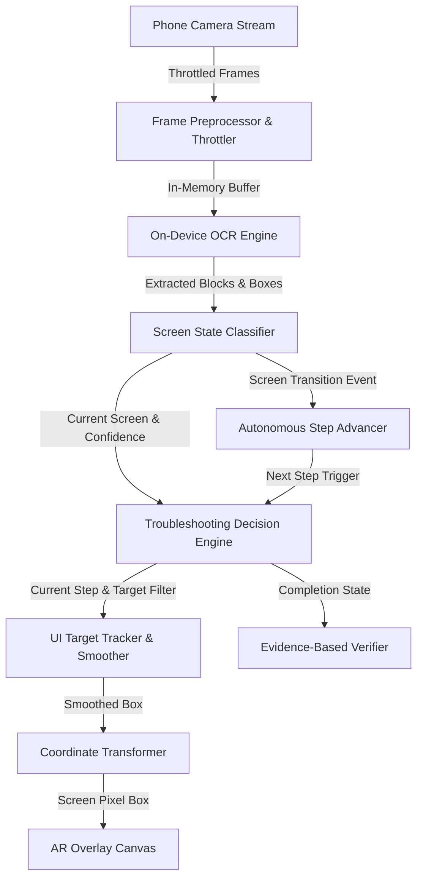

# FixLens System Architecture

## 1. Overview

FixLens is designed as a fully on-device, zero-cost, real-time computer troubleshooting assistant. It uses smartphone camera input to identify Windows operating system screens, detects error states, tracks UI control elements in real-time, and overlays augmented-reality (AR) visual guidance to walk users through solutions.



---

## 2. Core Subsystems

### 2.1 Camera Capture & Lifecycle Subsystem
- **Component**: Camera viewport managed via React Native Camera / Expo Camera.
- **Lifecycle Management**:
  - Automatically suspends streaming and frame analysis when the user navigates away or when the app is placed in the background (`AppState` listener).
  - Explicit camera activation indicator to guarantee user privacy.
  - Zero recording or image transmission: frames are processed in volatile memory only.

### 2.2 Frame Processing & Throttling Subsystem
- **Challenge**: OCR on every 60fps / 30fps camera frame causes high thermal load and battery drain.
- **Solution**: Dynamic frame throttling.
  - Processing interval defaults to `600ms` (configurable to `1200ms` in Low-Performance mode).
  - **Single-Flight Lock**: If an analysis pass is already in progress, upcoming frames are dropped until the active pass resolves.

### 2.3 On-Device OCR Pipeline
- **Engine**: Google ML Kit Text Recognition (On-Device) / Local fallback analyzer.
- **Output Data Structure**:
  - Hierarchy: Blocks -> Lines -> Elements.
  - Bounding box $(left, top, width, height)$ in camera sensor coordinate space.
  - Text strings with normalized lowercase and alphanumeric fuzzy tokens.

### 2.4 Screen State Classifier
The classifier determines what Windows screen or window is currently in view:
- **State Types**:
  - `WINDOWS_DESKTOP`: Taskbar, System Tray, Start button, Desktop icons.
  - `QUICK_SETTINGS`: Network/Volume flyout, Wi-Fi quick toggle, Mobile hotspot quick toggle.
  - `SETTINGS_NETWORK_INTERNET`: Windows Settings with Network & Internet sidebar/header.
  - `SETTINGS_MOBILE_HOTSPOT`: Dedicated Mobile Hotspot settings page with sharing options.
  - `HOTSPOT_ERROR_STATE`: Known error banners (e.g. *"We can't set up mobile hotspot because your PC doesn't have an Ethernet, Wi-Fi, or cellular data connection"* or *"Turn on Wi-Fi to use mobile hotspot"*).
  - `HOTSPOT_ACTIVE_STATE`: Successful broadcasting state ("Sharing over: Wi-Fi", devices connected count).
  - `UNKNOWN_OR_OBSCURED`: Confidence below threshold, blurry, extreme angle, or unrecognized screen.
- **Hysteresis & Anti-Flapping**:
  - Requires 2 consecutive matching detections to switch states, preventing flicker caused by brief sensor noise or glare.

### 2.5 Troubleshooting Decision Engine
- Formulates a directed state graph for each supported computer problem.
- Evaluates the current screen state against expected prerequisites.
- Directs the target selector to find the exact control the user must click (e.g., the Network icon in the system tray, or the "Mobile Hotspot" toggle switch).
- Provides guidance actions: `Repeat`, `Back`, `Skip`, `Not Working`.

### 2.6 Coordinate Transformer & AR Guidance
- **Mathematical Transformation**:
  The camera sensor captures frames at resolution $(W_f \times H_f)$ (e.g., $1920 \times 1080$), while the mobile screen preview renders at $(W_v \times H_v)$ using `aspectFill` or `aspectFit`.
  
  Let scale factor $S = \max(W_v / W_f, H_v / H_f)$ (for `aspectFill`).
  Let offset $X_{off} = (W_v - W_f \cdot S) / 2$
  Let offset $Y_{off} = (H_v - H_f \cdot S) / 2$

  The mapped point $(X_p, Y_p)$ in overlay pixels is:
  $$X_p = X_f \cdot S + X_{off}$$
  $$Y_p = Y_f \cdot S + Y_{off}$$
  
  For front-facing or rotated sensors, orientation matrix adjustments ($90^\circ, 180^\circ, 270^\circ$) are applied before rendering.

- **Jitter Smoothing**:
  Uses an Exponential Moving Average (EMA) filter on bounding box coordinates:
  $$B_{smooth}(t) = \alpha \cdot B_{raw}(t) + (1 - \alpha) \cdot B_{smooth}(t - 1)$$
  with $\alpha = 0.45$ for balanced responsiveness and stability.

### 2.7 Autonomous Screen Progression
- Listens for screen state transitions. When the user clicks the highlighted target on the PC, the PC screen changes (e.g., Quick Settings flyout opens).
- Once the classifier confirms the new state for `> 400ms`, the engine automatically advances to the next troubleshooting step and repositions the visual highlight.

### 2.8 Verification Subsystem
- Once the solution reaches its final intended state, the system scans for explicit proof of resolution:
  - For Hotspot: presence of "Sharing over", active toggle status, or "Network band: 5 GHz / 2.4 GHz".
- Displays an evidence confirmation summary or offers secondary recovery steps if the issue remains unresolved.

---

## 3. Data Models (TypeScript)

```typescript
export interface BoundingBox {
  x: number;
  y: number;
  width: number;
  height: number;
}

export interface OCRTextElement {
  text: string;
  confidence: number;
  boundingBox: BoundingBox;
}

export interface OCRResult {
  rawText: string;
  elements: OCRTextElement[];
  frameWidth: number;
  frameHeight: number;
  timestamp: number;
}

export type RecognizedScreenType = 
  | 'DESKTOP_TASKBAR'
  | 'QUICK_SETTINGS_PANEL'
  | 'SETTINGS_NETWORK'
  | 'SETTINGS_MOBILE_HOTSPOT'
  | 'HOTSPOT_ERROR_CANNOT_SETUP'
  | 'HOTSPOT_ACTIVE_VERIFIED'
  | 'UNKNOWN_SCREEN';

export interface ScreenClassification {
  screenType: RecognizedScreenType;
  confidence: number; // 0.0 to 1.0
  matchedKeywords: string[];
  keyElements: Record<string, BoundingBox>;
}

export interface TroubleshootingStep {
  stepId: string;
  stepNumber: number;
  totalSteps: number;
  title: string;
  instruction: string;
  expectedScreen: RecognizedScreenType;
  targetControlKey: string;
  alternateAction?: string;
  isVerificationStep?: boolean;
}

export interface TroubleshootingWorkflow {
  workflowId: string;
  title: string;
  description: string;
  category: 'NETWORK' | 'UPDATE' | 'AUDIO' | 'SYSTEM';
  steps: TroubleshootingStep[];
}
```
