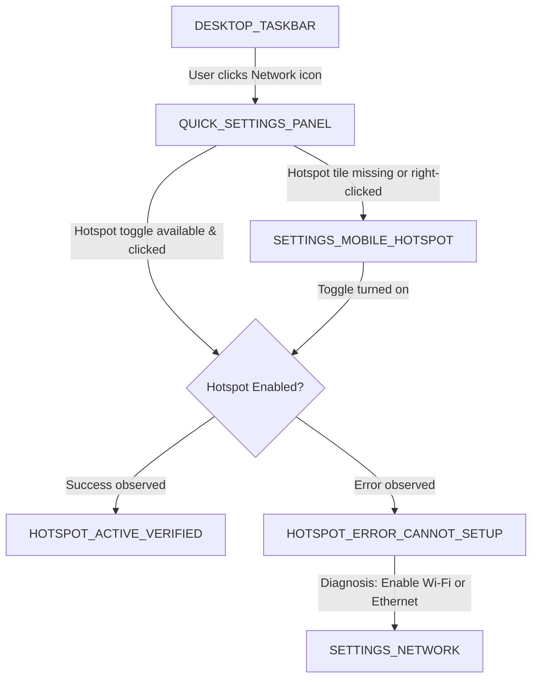

# Troubleshooting Workflows & Diagnostics

FixLens uses a state-driven diagnostic engine. Each workflow is structured as a directed graph of computer screen states, prerequisite checks, target UI controls, and expected transitions.

---

## 1. Primary Workflow: Windows 11 Mobile Hotspot Troubleshooting

### 1.1 Problem Overview
Windows 11 Mobile Hotspot allows a PC to share its active Internet connection (Ethernet or Cellular) over Wi-Fi with other devices. Common failure modes:
1. User cannot find where to activate Hotspot.
2. Hotspot toggle fails with *"We can't set up mobile hotspot because your PC doesn't have an Ethernet, Wi-Fi, or cellular data connection"*.
3. PC Wi-Fi adapter is turned off or in Airplane mode.
4. Mobile hotspot is broadcasting on 5 GHz which older client devices cannot detect.

### 1.2 State Transition Graph

### 1.3 Step-by-Step Diagnostic Script

#### Step 1: Open Quick Settings
- **Recognized Screen**: `DESKTOP_TASKBAR`
- **Target UI Element**: Network / Volume / Battery tray cluster (bottom-right on Windows 11 taskbar).
- **Instruction**: *"Tap or click the Network/Sound icon cluster near the bottom-right clock on your Windows taskbar."*
- **Auto-Progression Trigger**: Detection of `QUICK_SETTINGS_PANEL`.

#### Step 2: Locate Mobile Hotspot Toggle
- **Recognized Screen**: `QUICK_SETTINGS_PANEL`
- **Target UI Element**: `Mobile hotspot` quick action tile.
- **Instruction**: *"Click the 'Mobile hotspot' tile to turn it on, or right-click it and select 'Go to Settings'."*
- **Auto-Progression Trigger**: Transition to `HOTSPOT_ACTIVE_VERIFIED` or `SETTINGS_MOBILE_HOTSPOT`.

#### Step 3: Configure Hotspot Settings (if error or customization needed)
- **Recognized Screen**: `SETTINGS_MOBILE_HOTSPOT`
- **Target UI Element**: Hotspot main toggle switch (`Turn on mobile hotspot`).
- **Secondary Target**: Network band selector (change from `5 GHz` to `Any available` if phones cannot see the network).
- **Instruction**: *"Click the switch to turn Mobile Hotspot On. Verify 'Share over: Wi-Fi' is selected."*

#### Step 4: Verification of Resolution
- **Recognized Screen**: `HOTSPOT_ACTIVE_VERIFIED`
- **Visual Evidence Required**:
  - Toggle state indicates `On`.
  - Text present: *"Network name"*, *"Network password"*, or *"Devices connected: 0 of 8"*.
- **Confirmation**: FixLens alerts the user: *"Mobile Hotspot is active and broadcasting."*

---

## 2. Additional Workflows (Modular Expansion)

### 2.1 Wi-Fi Connection Troubleshooter
- Recognizes: No Internet globe icon, Wi-Fi disabled, network list flyout.
- Guides user to re-enable Wi-Fi adapter or run Windows Network Diagnostics.

### 2.2 Windows Update Troubleshooter
- Recognizes: Windows Update error codes (`0x80070002`, `0x80244018`), retry buttons.
- Guides user through update service restart and Windows Update Troubleshooter utility.
